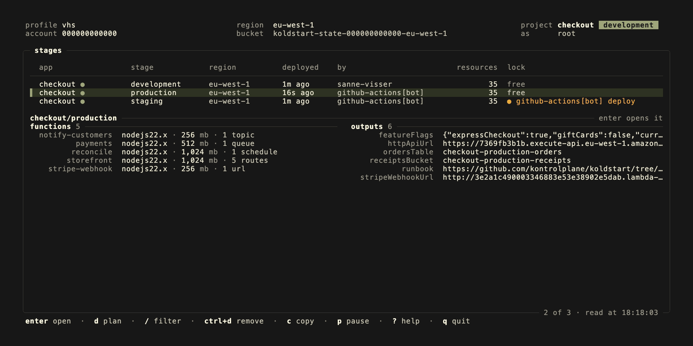

<p align="center">
  <a href="https://kontrolplane.dev">
    
  </a>
</p>

`koldstart` deploys serverless applications to `AWS Lambda`. You describe your functions, the events that trigger them and the resources they use in a [pkl](https://pkl-lang.org/) file, and koldstart builds, packages and deploys them into your own AWS account. It is free to use without limits: no license key, no hosted dashboard, no telemetry and nothing running outside your account. `kdst` is the short name for the same binary.



---

> [!NOTE]
> koldstart has no release yet: 0.1.0 is next. Everything below is built; the plan is in [#1](https://github.com/kontrolplane/koldstart/issues/1).

Here is an http api in typescript and a queue worker in go, sharing a table. Neither function sets a runtime or handler: koldstart infers them from the function's name and its files, `src/api.ts` and `cmd/worker/`, as [conventions](docs/configuration.md#conventions) describes. [examples/full-featured](./examples/full-featured) is a complete version of it, with the handlers:

```pkl
amends "@koldstart/Project.pkl"

import "@koldstart/kdst.pkl"

app = "orders"
region = "eu-west-1"

functions {
  ["api"] {
    memory = if (kdst.stage == "prod") 1024 else 256
    environment {
      ["API_KEY"] = kdst.param("api-key")
    }
    link { ["orders"] = "read" }
    events {
      kdst.get("/orders/{id}")
      kdst.post("/orders")
    }
  }
  ["worker"] {
    link { ["orders"] = "readwrite" }
    events {
      kdst.fromQueue("jobs")
    }
  }
}

resources {
  ["orders"] = kdst.table("id")
  ["jobs"] = (kdst.queue()) { properties { VisibilityTimeout = 60 } }
}
```

The file amends `Project.pkl`, which gives you type checking and completion in any editor with a pkl plugin, and imports `kdst.pkl` for what goes inside functions and resources: `kdst.stage`, `kdst.ref()`, the secrets, the events and the resource shorthands. Both come from the schema package of a koldstart release, which a `PklProject` beside the file names once:

```pkl
amends "pkl:Project"

dependencies {
  ["koldstart"] { uri = "package://github.com/kontrolplane/koldstart/releases/download/v0.1.0/koldstart@0.1.0" }
}
```

`kdst.stage` is whatever `--stage` was set to, so one file describes every stage; here the api gets more memory in `prod`. `kdst.get()` and `kdst.post()` are routes of the stage's http api, and `kdst.fromQueue("jobs")` reads the queue `jobs` of the project. `link` lets a function use a resource: its role may read or write it, and its name and arn arrive as `ORDERS_NAME` and `ORDERS_ARN`. `resources` takes any `AWS::*` type, created through the cloud control api; `kdst.table("id")` is an on-demand table keyed by `id`, with point-in-time recovery, and `kdst.queue()` a queue, here amended to hide a message for 60 seconds. `kdst.ref()` reads an attribute of a resource once it exists, and `kdst.param("api-key")` is read from parameter store during the deploy, as `/orders/prod/api-key` for `prod`.

```bash
kdst plan --stage prod
kdst deploy --stage prod
```

`plan` shows what would change and touches nothing. `deploy` builds the functions, uploads them, shows the plan and applies it once you say yes.

## highlights

koldstart calls the AWS APIs directly instead of generating CloudFormation, so there is no stack to wait on and no 500 resource limit. When the only change is a function's code, a deploy uploads the new zip and makes one `UpdateFunctionCode` call. `kdst deploy function -f api` goes straight down that path.

What was deployed is recorded in an S3 bucket in your account, created on the first deploy. A team and its CI share it without setting anything up, and a lock in the same bucket keeps two deploys of one stage from running at once. Every step is recorded before it is made, so a deploy that fails or is stopped halfway is finished by the next one, with nothing made twice.

Functions are written in typescript, javascript, go or python, or are container images. Typescript is bundled with esbuild built into the binary, so packaging needs no node install. Go is cross-compiled to a `bootstrap` binary for the `provided.al2023` runtime. Python's dependencies are installed with uv for lambda's platform, native code included, from any machine. A container image is built with docker and pushed to ecr, and rebuilt only when what it is built from changes. Zips are built byte for byte the same from the same code, on a laptop and in CI, so their hash tells koldstart whether the code changed.

Functions are triggered by api gateway http and websocket routes, function urls, schedules, eventbridge rules, sqs queues, sns topics, kinesis and dynamodb streams, s3 buckets, and application load balancers. Anything else AWS offers goes in `resources`, with the same type names and properties as CloudFormation. Tables, buckets and other resources that hold data are kept when a stage is removed, and a resource made outside koldstart is taken over with `kdst import`.

`kdst invoke --local` and `kdst offline` run functions on your machine against an emulator of the lambda runtime api, with the variables the stage deployed and your credentials, so a handler runs locally the way it runs in AWS.

`kdst ui` opens a terminal interface on every app and stage of the account: their functions, resources, outputs and history, a function's logs as they come, and invoking it. In a project's directory it plans and applies deploys too.

Coming from the serverless framework, `kdst migrate` converts a `serverless.yml` into a `koldstart.pkl`, and lists what it left to you.

## installation

There is no release yet. To build koldstart from source, with [go](https://go.dev/) 1.26 or later:

```bash
go install github.com/kontrolplane/koldstart/cmd/koldstart@latest
alias kdst=koldstart
```

koldstart evaluates configuration with the `pkl` binary. It uses the one `KOLDSTART_PKL` points at, or a `pkl` 0.30 or later on the `PATH`; without either, it downloads the version it pins to `~/.cache/koldstart`, or `$XDG_CACHE_HOME/koldstart`, on first use and checks it against the checksum built into koldstart.

A release of koldstart writes its own version's schema package into the `PklProject` of a new project, and pkl downloads it from that release on GitHub the first time the project is resolved. A build from source, such as `go install` before 0.1.0 is out, has no release to point at: it writes a dependency on the schema built into it instead, extracted to `~/.cache/koldstart/schema/`, so it works offline and needs nothing published.

Once released, koldstart installs with `brew install kontrolplane/tap/koldstart`, which installs `kdst` and pkl with it, as binaries for linux and macos on the [GitHub releases](https://github.com/kontrolplane/koldstart/releases), and as a container image, `ghcr.io/kontrolplane/koldstart`, for linux/amd64 and linux/arm64. The image holds koldstart, pkl, go and uv, so it builds typescript, javascript, go and python functions; node and docker are not in it, so `typecheck`, `invoke --local`, `offline` and container image functions run elsewhere.

## getting started

`init` starts a project: a `koldstart.pkl` with one function behind `GET /hello`, its handler in typescript, or go or python with `--template go` or `--template python`, the `PklProject` that names the schema, and the entries koldstart needs in `.gitignore`. It keeps any other file that is there already, and writes over a `koldstart.pkl` only with `--force`.

```bash
kdst init orders
cd orders
```

`init` resolves the `PklProject` into `PklProject.deps.json`, pkl's lock file, which pins the schema package by its checksum: commit both. When it cannot, offline for one, it says so and keeps the files, and the next command that reads the configuration, such as `plan`, resolves it first. So does any command after the `PklProject` changes.

Without `--stage`, every command works on `dev`. The first plan lists everything as a create: here the function with its role and log group, and the http api with its route, integration and permission. A project like the one above has the queue mapping, the table and the queue too.

```bash
kdst plan
kdst deploy
```

`plan` prints a line for each change, `+` to create, `~` to update, `-/+` to replace and `-` to delete, and counts them: `7 to create`. `deploy` prints the same plan and asks before applying it. While it applies, a line on stderr says what was done to each resource and how long it took, `✓ function/api  created in 1.2s`, and it ends with what it did, `deployed orders/dev in 9.8s: 7 created`. `plan -o json` prints the plan as one json object, for a script to check before a deploy.

The first deploy in an account and region also creates the state bucket. When it finishes, it prints the outputs, the url of the http api, `httpApiUrl`, among them. `outputs` prints them again, and `-o json` prints them as one json object for a script:

```bash
kdst outputs
curl "$(kdst outputs -o json | jq -r .httpApiUrl)/hello"
```

Invoke a function with an event from a file or inline, and follow its logs:

```bash
kdst invoke -f api --path events/get-order.json
kdst logs -f api --tail
```

On a terminal, `invoke` indents and colours the json the function returned, and piped it prints it byte for byte, so `kdst invoke -f api | jq` works. A function that fails prints its error and stack trace on stderr and exits with 1. `logs` shows a line of json from a structured logger, such as powertools, pino or zap, with its level and message first, and `-o json` prints each event as one json object a line:

```bash
kdst logs -f api --since 1h -o json | jq -r 'select(.fields.level == "ERROR") | .message'
```

After changing only a function's code, deploy just that function. It replaces the code in place without asking, and refuses when the function's configuration changed too:

```bash
kdst deploy function -f api
```

`remove` deletes everything the stage deployed, after listing it and asking you to type the stage name. Tables, buckets and other resources that hold data are left in place and listed, and the next deploy of the stage takes them over again:

```bash
kdst remove
```

## stages

Every stage is deployed separately, with its own functions, resources, state and lock, so `dev`, a stage per pull request and `prod` can live in the same account without touching each other. Small differences go in the main file through `kdst.stage`. A stage that differs a lot gets its own file that amends the main one, such as a `koldstart.prod.pkl` with:

```pkl
amends "koldstart.pkl"

region = "us-east-1"

functions {
  ["api"] { memory = 2048 }
}
```

```bash
kdst deploy --stage prod --config koldstart.prod.pkl
```

One app can read another's outputs with `kdst.stageOutput("payments", kdst.stage, "apiUrl")`, from the state of that stage. That stage can be in another region, or in another account through a role koldstart assumes: `(kdst.stageOutput("payments", "prod", "apiUrl")) { region = "us-east-1" }`.

## secrets

`kdst.param("api-key")` reads the parameter `/<app>/<stage>/api-key` from ssm parameter store, `kdst.secret("db")` reads the secret `<app>/<stage>/db` from secrets manager, and `.field("key")` takes one key of a json secret. For a full name or arn, such as one every stage shares, use `kdst.ssm("/path")` and `kdst.secretsmanager("name")`. They are read during the deploy and become environment variables of the function, so anyone who can read the function's configuration can read them too. Their values never go into the state.

To keep a secret out of the configuration, add `.readAtRuntime()`: the variable then holds the arn of the parameter or secret, the function's role may read it, and the function reads it itself. With a `.field()`, a second variable, `<NAME>_KEY`, says which key to take.

## local development

`invoke --local` builds one function for your machine and runs it against an emulator of the lambda runtime api, with the variables the stage deployed and your aws credentials, so it reads and writes what the stage deployed:

```bash
kdst invoke -f worker --local --path events/job.json
```

A python function runs with the version of python its runtime names, which [uv](https://docs.astral.sh/uv/) finds or installs once, its dependencies installed for it. A container image function is built for this machine and runs in docker, pointed at the same emulator. A function's layers are not added here, so what they put under `/opt` is missing; koldstart says so when it runs one.

`offline` serves every http route of the stage on `127.0.0.1:3000`, so the api can be called with curl or a browser while you work on it. A change to a source file rebuilds the functions, and the next request runs the new code:

```bash
kdst offline
```

A variable that should be something else on your machine goes in `.koldstart/local.<stage>.pkl`:

```pkl
functions {
  ["api"] { ["TABLE_NAME"] = "orders-on-my-laptop" }
}
```

Running against `prod` asks first, since the function then works with prod's data.

## deploying from ci

A ci job needs aws credentials and nothing else: the state bucket and the lock are already shared with everyone who deploys the app. With GitHub Actions and an iam role it can assume through oidc:

```yaml
name: deploy

on:
  push:
    branches: [main]

permissions:
  id-token: write
  contents: read

jobs:
  deploy:
    runs-on: ubuntu-latest
    steps:
      - uses: actions/checkout@v7
      - uses: actions/setup-go@v7
      - uses: aws-actions/configure-aws-credentials@v6
        with:
          role-to-assume: arn:aws:iam::123456789012:role/koldstart-deploy
          aws-region: eu-west-1
      - run: go run github.com/kontrolplane/koldstart/cmd/koldstart@latest deploy --stage prod --yes
```

The image runs the same in a container job, with no go, pkl or koldstart to install. Pin the version you tested with:

```yaml
jobs:
  deploy:
    runs-on: ubuntu-latest
    container: ghcr.io/kontrolplane/koldstart:0.1
    steps:
      - uses: actions/checkout@v7
      - uses: aws-actions/configure-aws-credentials@v6
        with:
          role-to-assume: arn:aws:iam::123456789012:role/koldstart-deploy
          aws-region: eu-west-1
      - run: kdst deploy --stage prod --yes
```

The image runs as root, so the checkout it builds in is writable. To run it on your machine, pass your own user, so the files it writes stay yours: `docker run --rm --user "$(id -u):$(id -g)" -v "$PWD:/work" ghcr.io/kontrolplane/koldstart:0.1 plan`.

`--yes` applies the plan without asking, which a deploy without a terminal needs. Without a terminal, progress is a plain line for each resource as it finishes, and one still going after 30 seconds says so every 30 seconds. The role needs permission to manage what the configuration describes, and to read and write the state bucket. A cancelled job gets a SIGTERM, which stops the deploy, records what it did and releases the lock: running it again finishes the deploy. When the runner itself was killed and the lock was left behind, a deploy names who holds it and the url of their run, and `kdst unlock --stage prod --yes` releases it.

## upgrading

A project keeps the schema its `PklProject` names until you change it, whichever koldstart reads it. After installing a newer koldstart, move the project to its schema, and commit the two files it changes:

```bash
kdst upgrade
```

It prints what changed, `koldstart 0.1.0 → 0.2.0`, and resolves `PklProject.deps.json` again. It refuses to go back to an older release without `--force`, and writes a `PklProject` for a file that has none. `kdst upgrade --check` changes nothing and exits with 1 when an upgrade is wanted, for CI.

A koldstart refuses a file whose schema is newer than it reads, and says to upgrade koldstart: the schema has a version of its own, which goes up only when an older koldstart could not read what it renders.

A file without a `PklProject` that amends the full `package://` uri of the schema still works. To move it to `@koldstart/`, run `kdst upgrade`, which writes the `PklProject`, and change its `amends` and `import` to `@koldstart/Project.pkl` and `@koldstart/kdst.pkl`.

## what ends up in your account

- for each function: the lambda function, an iam role, a log group, and the permissions its events need to invoke it
- for each stage with http routes: one api gateway http api that all its routes share
- everything in `resources`, created through the cloud control api
- per account and region: one bucket, `koldstart-state-<account>-<region>`, versioned, encrypted and with public access blocked, holding the state, locks and zips of every app and stage. Zips expire after 90 days, and each state keeps its last 100 versions.

Everything koldstart creates is tagged with its app, stage and node, together with the `tags` from the configuration. Nothing else is created, and nothing is sent anywhere outside your account.

## not supported yet

- runtimes other than node, go and python
- the rest api of api gateway, only http apis are deployed
- windows, other than through the container image

## commands

| command                          | description                                                                     |
| -------------------------------- | ------------------------------------------------------------------------------- |
| `init [directory]`               | start a project: a `koldstart.pkl`, its `PklProject`, a handler and the `.gitignore` entries |
| `package`                        | build and zip every function, without deploying                                 |
| `plan`                           | show what a deploy would create, change and delete, `--refresh` to read aws too  |
| `deploy`                         | build, upload and apply the plan                                                |
| `deploy function -f <fn>`        | deploy only the code of one function                                            |
| `remove`                         | delete everything the stage deployed, leaving resources that hold data in place |
| `import <resource> <identifier>` | take over a resource koldstart did not create                                   |
| `outputs`                        | print the stage's outputs, such as the http api url                             |
| `invoke -f <fn>`                 | invoke a function with `--data` or `--path`, `--local` to run it here            |
| `offline`                        | serve the http routes on this machine                                           |
| `logs -f <fn>`                   | print a function's logs, `--tail` to follow them                                |
| `migrate [serverless.yml]`       | convert a serverless framework project                                          |
| `upgrade`                        | point the `PklProject` at this koldstart's schema, `--check` to only say if it is wanted |
| `ui`                             | open the terminal interface                                                     |
| `unlock`                         | release a stage's lock left by a deploy that did not finish                     |
| `version`                        | print the version                                                               |
| `completion <shell>`             | print the completion script for bash, fish, powershell or zsh                   |
| `help [command]`                 | print the help of a command                                                     |

## flags

| flag             | environment variable | description                                                     |
| ---------------- | -------------------- | --------------------------------------------------------------- |
| `--stage`, `-s`  | `KOLDSTART_STAGE`    | stage to work on, defaults to `dev`                             |
| `--config`, `-c` | `KOLDSTART_CONFIG`   | configuration file, defaults to `koldstart.pkl`                 |
| `--profile`      | `AWS_PROFILE`        | aws profile from the shared aws config                          |
| `--region`       | `AWS_REGION`         | aws region, takes precedence over `region` in the configuration |
| `--debug`        |                      | write debug logs to `debug.log` in the current directory        |
| `--version`      |                      | print the version and exit, as `kdst --version`                 |
| `--help`, `-h`   |                      | print the help of the command and exit                          |

Credentials come from the standard aws chain: environment variables, the shared config and credentials files, sso, and the role of the machine or ci job koldstart runs on.

A few more environment variables change what koldstart does:

| environment variable                 | description                                                                  |
| ------------------------------------ | ---------------------------------------------------------------------------- |
| `KOLDSTART_PKL`                      | the pkl binary to evaluate configuration with                                |
| `AWS_ENDPOINT_URL`                   | an endpoint for every aws api, such as an emulator; `endpoint_url` in a profile does the same, as in [hack/floci/aws-config](./hack/floci/aws-config) |
| `NO_COLOR`                           | no colour in the output of `plan`, `deploy`, `remove`, `invoke` and `logs`   |
| `VISUAL`, `EDITOR`                   | the editor `ui` edits events in, `vi` without either                         |

A command that fails exits with 1, and a command line that is refused, such as an unknown flag, with 2. One that ctrl+c or SIGTERM stops before it is done, such as a deploy, exits with 130; `logs --tail` and `offline`, which run until they are stopped, exit with 0.

## documentation

- [configuration](./docs/configuration.md): the pkl schema, functions, events, resources, references, stages and secrets
- [how it works](./docs/how-it-works.md): planning, applying, the output for scripts, state, locking and what happens when a deploy fails
- [terminal interface](./docs/ui.md): the views and keys of `kdst ui`
- [migrating from the serverless framework](./docs/migrating.md): what `kdst migrate` converts and what it leaves to you

## development

- [go](https://go.dev/) 1.26+
- [pkl](https://pkl-lang.org/), for the schema tests, which skip without it
- [node](https://nodejs.org/) 22+, only for `invoke --local` and `offline` with javascript functions
- [docker](https://www.docker.com/), for the tests that run against [floci](https://github.com/floci-io/floci), a local aws emulator
- [vhs](https://github.com/charmbracelet/vhs) with `ffmpeg` and `ttyd`, only to record the readme gif and screenshots

```bash
make test
make emulator test-emulator
make check
make vhs
```

`make test` runs the unit tests, against fakes and an in-memory state, with no aws account. `make emulator test-emulator` runs the tests that talk to aws against floci, and `make emulator-down` stops it. `make check` runs what CI runs. `make vhs` records the gif above and a screenshot of each page in `assets/pages/`, against [vhs/shop](./vhs/shop) deployed to a floci of its own on 127.0.0.1:4567. `go test -tags e2e ./test/e2e/...` deploys [examples/full-featured](./examples/full-featured) to a real account, with the credentials you have, and removes it again. [CONTRIBUTING.md](./CONTRIBUTING.md) and [AGENTS.md](./AGENTS.md) have the rest.

## license

[Apache-2.0](./LICENSE) © kontrolplane.

## contributors

[//]: kontrolplane/generate-contributors-list

<a href="https://github.com/levivannoort"></a>

[//]: kontrolplane/generate-contributors-list

</br>

<p align="center">
  
</p>
