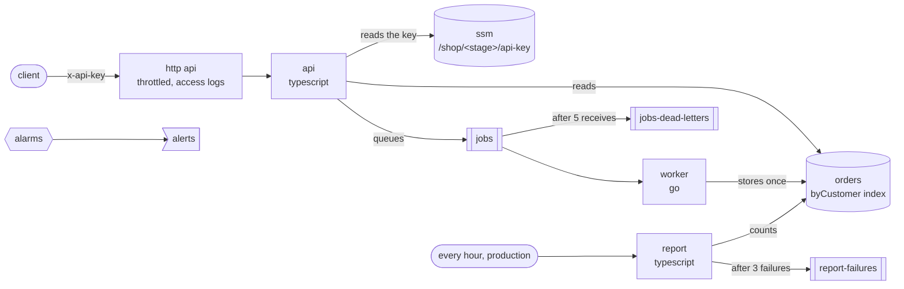

# reference-application

The reference application: the order service of a web shop, `shop`, in [koldstart.pkl](./koldstart.pkl), set up as a team would run it in production, with the [concepts](../concepts) and [runtimes](../runtimes) together in one application: an http api in typescript that accepts orders and queues them, a worker in go that stores each one once, and an hourly report in typescript, with a dead-letter queue, alarms that page, a secret the api reads itself, and the unit tests of each handler.



| what                   | where                                                                                       |
| ---------------------- | ------------------------------------------------------------------------------------------- |
| stages                 | `local stages`: what development, staging and production differ in; any other stage is sized as development |
| tags                   | service, team, owner, cost centre, environment and data classification, on everything        |
| defaults               | `functions { default { ... } }`: json logs at the stage's level, x-ray tracing, retention    |
| http routes            | `api`: `POST /orders`, `GET /orders/{id}` and `GET /customers/{customerId}/orders`           |
| the http api           | `http`: a limit on requests, access logs, and cors for the stage's storefront alone          |
| a queue                | `worker` reads `jobs`, at most `workers` at once, retrying only the orders that failed       |
| a dead-letter queue    | `jobs`' `RedrivePolicy` gives up on an order after five receives, into `jobs-dead-letters`    |
| a schedule             | `report`, every hour on production; an invocation that fails three times goes to `report-failures` |
| a table                | `orders`, with an index of each customer's orders, kms encryption, and deletion protection on production |
| least privilege        | `link`: the api only reads `orders` and only sends to `jobs`; the worker only writes         |
| a secret               | `kdst.param("api-key").readAtRuntime()`: the api reads it from ssm, so it is in no configuration |
| alarms                 | errors, throttles and duration of every function, the backlog of `jobs`, the dead letters    |
| outputs                | `ordersTable`, `alertsTopic` and `deadLetterQueue`                                          |
| events to invoke with  | [.koldstart/events](./.koldstart/events), for `kdst ui` and `kdst invoke --path`             |

The alarms are made from `functions`, with a `for` in `resources`, so a function added later gets its own. Each one's description links the section of [the runbook](#runbook) below on what to do. `jobs`' visibility timeout is six times the worker's timeout, worked out from it, so the two cannot drift apart.

The worker is a go module of its own, [go.mod](./go.mod), with its `toolchain` pinned so every machine builds the same zip. The typescript is bundled by koldstart, with the aws sdk from `node_modules`, and runs as it is in node's test runner.

[PklProject](./PklProject) names the schema, the package of koldstart 0.1.0, which `koldstart.pkl` imports as `@koldstart/`. Its lock file, `PklProject.deps.json`, holds the package's checksum, so it can only be written once 0.1.0 is published: until then it is not here, and the first `kdst plan` with a release writes it, to be committed. [examples_test.go](../examples_test.go) evaluates the example against the schema in this tree, `pkl/`, so it needs neither the package nor the lock file.

## concepts it uses

[stages](../concepts/stages), [tags](../concepts/tags), [defaults](../concepts/defaults), [http routes](../concepts/http-routes), [link](../concepts/link), [secrets](../concepts/secrets), [queues](../concepts/queues), [dead-letter queues](../concepts/dead-letter-queues), [schedules](../concepts/schedules), [resources](../concepts/resources), [alarms](../concepts/alarms) and [outputs](../concepts/outputs), in the [typescript](../runtimes/typescript) and [go](../runtimes/go) runtimes.

## stages

|                         | development           | staging                            | production                 |
| ----------------------- | --------------------- | ---------------------------------- | -------------------------- |
| api memory              | 256 megabytes         | 512 megabytes                      | 1024 megabytes             |
| log level               | `DEBUG`               | `INFO`                             | `INFO`                     |
| log retention           | 14 days               | 30 days                            | 365 days                   |
| requests per second     | 50, bursts of 100     | 100, bursts of 200                 | 500, bursts of 1000        |
| workers at once         | 2                     | 5                                  | 20                         |
| cors origin             | `http://localhost:5173` | `https://staging.shop.example.com` | `https://shop.example.com` |
| the hourly report       | off                   | off                                | on                         |
| alarms page             | no                    | no                                 | yes                        |
| table deletion protection | off                 | off                                | on                         |

A stage of another name, as `kdst deploy --stage pull-request-142` for a pull request, gets development's settings and its own resources, and `kdst remove --stage pull-request-142` deletes them. So does `kdst` without `--stage`, which picks a stage name of its own: pass `--stage` every time, or set `KOLDSTART_STAGE=development`.

## deploying it

Each stage reads its api key from `/shop/<stage>/api-key`. Put one there before the first deploy of a stage:

```bash
npm ci
aws ssm put-parameter --name /shop/development/api-key --type SecureString --value "$(openssl rand -hex 32)"
kdst plan --stage development
kdst deploy --stage development
```

Then, with the url `deploy` prints and the key:

```bash
curl --request POST "$URL/orders" --header "x-api-key: $KEY" --header "idempotency-key: checkout-7f3a91c2" \
  --data '{"customerId": "customer-1042", "lines": [{"sku": "socks", "quantity": 2}]}'
curl "$URL/orders/<id>" --header "x-api-key: $KEY"
curl "$URL/customers/customer-1042/orders?limit=10" --header "x-api-key: $KEY"
kdst logs --stage development --function worker --tail
```

The first answers `202` with the order's id: the order is queued, and the worker stores it a moment later. Sending it again with the same `idempotency-key` answers with the same id, and the worker stores the order once. An order the api refuses is answered with a `400` in `application/problem+json`, which says what is wrong with it. A page of a customer's orders holds a `next` cursor when there are more, for `?cursor=`.

`kdst invoke --stage development --function worker --path .koldstart/events/worker/poison-message.json` hands the worker a message it can never store, as `kdst ui` does from the function's invoke tab: it answers with the message in `batchItemFailures`, which sqs would deliver again, five times at most before `jobs-dead-letters`.

To rotate the key, put a new value: the api takes it up within five minutes, without a deploy.

On production, subscribe the on-call tool to the `alertsTopic` output, as `kdst outputs --stage production` prints it. development and staging have the same alarms, which show in cloudwatch and notify no one.

`kdst remove --stage development` deletes the stage, and leaves `orders` in place, as it holds data. On production its deletion protection has to be turned off first.

## testing it

```bash
npm test
npm run typecheck
go test ./...
```

The handlers are written against small interfaces, so the tests run them against fakes, with no aws account and no network: the api's routes, its key check, its validation and its idempotency, and the worker's handling of a batch with orders it stores, orders it has already stored, and messages it can never store. `make test-examples` in the root of the repository runs them for every example, as continuous integration does.

The [end-to-end tests](../../test/e2e) deploy this example to a sandbox account on every push to main, and every night.

## runbook

Each alarm is named `shop-<stage>-<what>`, and links the section here on what to do.

### errors

More than 1% of a function's invocations failed in three of five minutes. `kdst logs --stage <stage> --function <function> --since 15m` shows them: the api logs `answering a request` with the error and the request's id, which a caller quotes from the `x-request-id` header. A deploy that brought it on is undone by deploying the commit before it.

### throttles

Lambda turned invocations away: the account or the function has run out of concurrency. For the api, raise the account's concurrency quota, or lower `http.throttling` so api gateway turns requests away first. For the worker, nothing is lost: the orders wait in `jobs`.

### duration

The slowest 1% of a function's invocations take more than 80% of its timeout. They are slowing down on what they call, dynamodb or ssm: the x-ray traces of the function show which. If they are slow for good, raise the function's `timeout`; `jobs`' visibility timeout follows the worker's.

### backlog

The oldest order in `jobs` has waited more than five minutes: the worker is failing or cannot keep up. If it is failing, see [errors](#errors). If it is not, raise `workers` for the stage.

### dead-letters

`jobs-dead-letters` or `report-failures` holds a message that was given up on. Read it with `aws sqs receive-message --queue-url "$(kdst outputs --stage <stage> --output json | jq --raw-output .deadLetterQueue)"`, and the worker's log for its message id. Once what made it fail is fixed, move the messages back with `aws sqs start-message-move-task --source-arn <arn of jobs-dead-letters>`, which sends them to `jobs` again.
